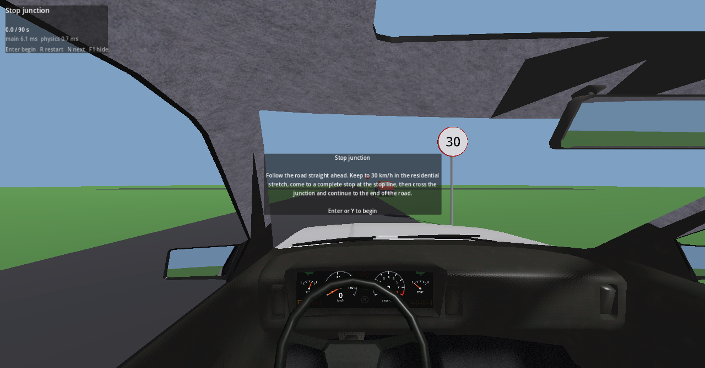
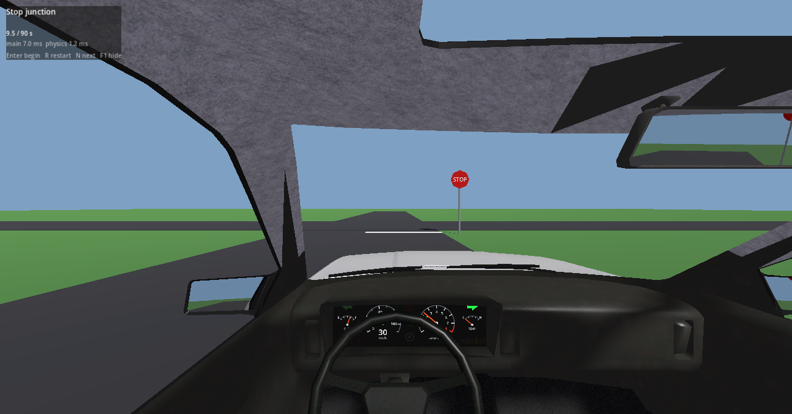
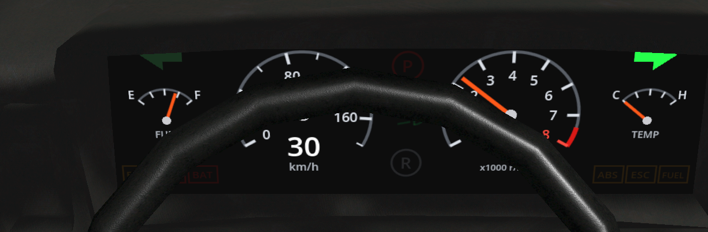
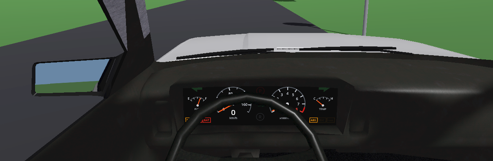
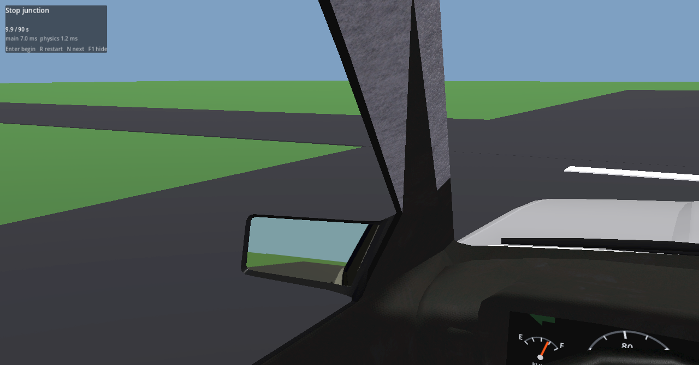
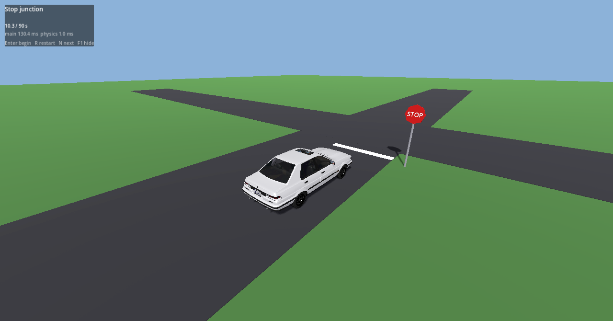
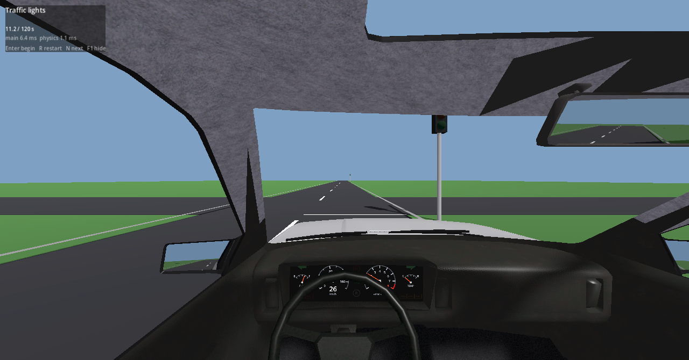
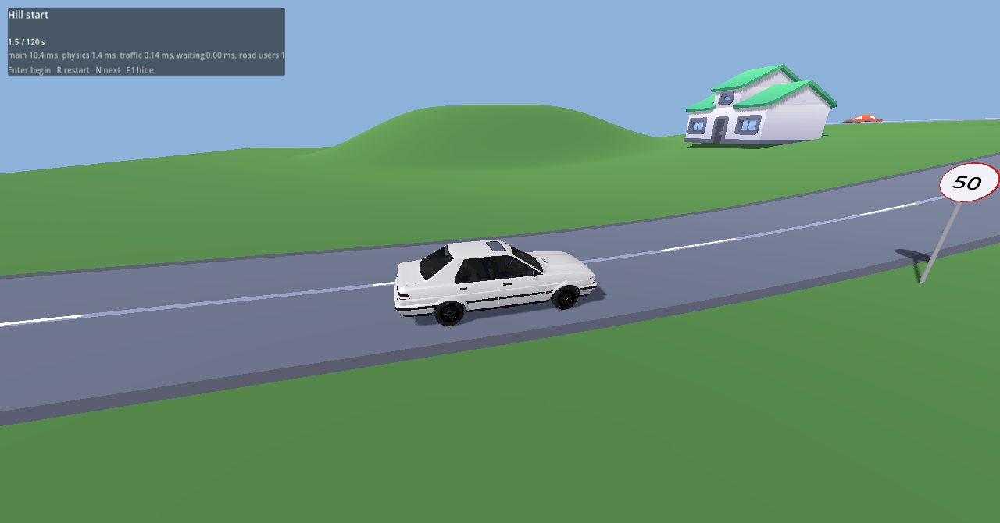

# Driving

This guide covers driving the simulator: the controls on every device, starting a scenario, the
car and its cabin, the views, driving in a headset and with a steering wheel, and how an attempt is
judged. The reference for every control and setting is the README's
[Controls](../README.md#controls) and [Virtual reality](../README.md#virtual-reality) sections;
this guide walks through them in the order a drive uses them.

## Controls

The gamepad is the reference layout: the motion controllers and a steering wheel match it one to
one, so a button does the same job on each.

<table>
  <thead>
    <tr>
      <th align="left">Action</th>
      <th align="left">PC</th>
      <th align="left">Controller</th>
      <th align="left">VR</th>
      <th align="left">Wheel</th>
    </tr>
  </thead>
  <tbody>
    <tr><th colspan="5" align="left">Driving</th></tr>
    <tr><td>Throttle</td><td><kbd>W</kbd></td><td>Right trigger</td><td>Right trigger</td><td>Throttle pedal</td></tr>
    <tr><td>Brake</td><td><kbd>S</kbd></td><td>Left trigger</td><td>Left trigger</td><td>Brake pedal</td></tr>
    <tr><td>Steer</td><td><kbd>A</kbd> <kbd>D</kbd></td><td>Left stick</td><td>Grip the wheel's rim and turn it</td><td>The rim, turned 1:1</td></tr>
    <tr><td>Handbrake</td><td><kbd>Space</kbd></td><td>A</td><td>Right A</td><td>A</td></tr>
    <tr><th colspan="5" align="left">The car</th></tr>
    <tr><td>Engine: hold to start, press to switch off</td><td><kbd>Enter</kbd></td><td>Y</td><td>Left Y</td><td>Y</td></tr>
    <tr><td>Gear lever up, down</td><td><kbd>Shift</kbd> <kbd>Ctrl</kbd></td><td>RB, LB</td><td>Flick the right stick up, down</td><td>Right, left paddle</td></tr>
    <tr><td>Park</td><td><kbd>P</kbd></td><td>Hold LB</td><td>Hold the right stick down</td><td>Hold the left paddle</td></tr>
    <tr><td>Indicators</td><td><kbd>Q</kbd> <kbd>E</kbd></td><td>D-pad left, right</td><td>Flick the left stick left, right</td><td>D-pad left, right</td></tr>
    <tr><td>Headlights</td><td><kbd>L</kbd></td><td>X</td><td>Left X</td><td>X</td></tr>
    <tr><th colspan="5" align="left">Mirrors</th></tr>
    <tr><td>Mirror switch: interior, left, right, then none</td><td><kbd>Tab</kbd></td><td>B</td><td>Right B, or grip the glass</td><td>B</td></tr>
    <tr><td>Tilt the picked mirror</td><td><kbd>←</kbd> <kbd>→</kbd> <kbd>↑</kbd> <kbd>↓</kbd></td><td>Right stick or D-pad</td><td>Right stick, or move the gripping hand</td><td>D-pad</td></tr>
    <tr><th colspan="5" align="left">Views</th></tr>
    <tr><td>Look around; in the chase view, orbit the car</td><td>Mouse</td><td>Right stick</td><td>The headset</td><td>The headset</td></tr>
    <tr><td>Chase view closer, farther</td><td>Mouse wheel</td><td></td><td></td><td></td></tr>
    <tr><td>Recentre the view</td><td><kbd>C</kbd></td><td>Right stick click</td><td>Right stick click, or both grips held for 2 s</td><td>Right stick button</td></tr>
    <tr><td>Line the car's wheel up with a real one</td><td></td><td></td><td>Hold the real rim with both controllers for 2 s</td><td></td></tr>
    <tr><td>Driver or chase view (in VR, the desktop's view)</td><td><kbd>V</kbd></td><td>View (Select)</td><td></td><td>View</td></tr>
    <tr><th colspan="5" align="left">The exam</th></tr>
    <tr><td>Begin the attempt after the briefing</td><td><kbd>Enter</kbd></td><td>Y</td><td>Left Y</td><td>Y</td></tr>
    <tr><td>Restart the attempt</td><td><kbd>R</kbd></td><td>D-pad up</td><td>Flick the left stick up</td><td>D-pad up</td></tr>
    <tr><td>Next scenario, or in free drive the next map</td><td><kbd>N</kbd></td><td>D-pad down</td><td>Flick the left stick down</td><td>D-pad down</td></tr>
    <tr><td>Menu (nothing opens yet)</td><td><kbd>Esc</kbd></td><td>Start (Menu)</td><td>Left menu button</td><td>Start (Menu)</td></tr>
    <tr><td>Show or hide the debug HUD</td><td><kbd>F1</kbd></td><td>Left stick click</td><td>Left stick click</td><td>Left stick button</td></tr>
    <tr><td>Free the mouse, recapture it</td><td><kbd>Backspace</kbd>, click</td><td></td><td></td><td></td></tr>
  </tbody>
</table>

The keys are the keys' places on a US layout, so they stay put on other layouts.

## Contents

1. [Controls](#controls)
2. [Starting a drive](#starting-a-drive)
3. [The car](#the-car)
4. [The cabin](#the-cabin)
5. [Views](#views)
6. [Driving in VR](#driving-in-vr)
7. [Driving with a steering wheel](#driving-with-a-steering-wheel)
8. [The exam](#the-exam)
9. [Hills](#hills)
10. [Settings](#settings)
11. [Known limits](#known-limits)

## Starting a drive

The game opens the scenario sandbox, which runs every scenario in the catalogue in turn and any
map in free drive. Each scenario starts on its briefing: what to do, and the key that begins.



- **Begin** with Enter or Y. The clock starts and the checks start judging.
- **Next** (N, D-pad down) moves to the next scenario, or in free drive to the next map.
- **Restart** (R, D-pad up) starts the attempt again from its briefing.

The scenarios, in the catalogue's order:

| Scenario | What it asks | Time |
|---|---|---|
| Stop junction | Keep to 30 km/h, stop at the stop line, cross the junction | 90 s |
| Traffic lights | Up to 50 km/h through two sets of lights: stop on red, and on amber when you safely can | 120 s |
| Pedestrian crossing | Over two crossings: give way to anyone crossing or waiting, never stop on one | 90 s |
| Lane change and overtaking | Keep a safe distance behind a slow vehicle, and overtake only where the centre line is dashed, with the mirror, a look over the shoulder, and the indicator | 120 s |
| Give way junction | Turn right onto the main road, giving way to its traffic until there is a safe gap | 120 s |
| Roundabout | Leave by the second exit, giving way to traffic on the roundabout and signalling right before leaving | 120 s |
| Bay parking | Reverse into a free bay, not a taken one, the reserved one, or the fire lane | 120 s |
| Parallel parking | Park close to the kerb in the gap between two parked cars, not on the no-parking line | 120 s |
| Busy junction | Through lights and a crossing in traffic that reacts to you, forcing no one to brake hard | 150 s |
| Hill start | Stop on the hill and pull away without rolling back | 120 s |

Free drive is a map with no checks but the contact, line, and conflict ones: drive where you like,
and restart at any time. Maps are made with the Map Kit ([Making maps](map-guide.md)).

## The car

The car is the Kiri '86, with a six speed automatic.

- **The engine.** It starts running, with the lever in P. Hold the key (Enter, Y) to turn the
  engine over until it catches; a press switches it off. It stalls when a gear is forced against
  the car's motion above a walking pace.
- **The lever.** It runs D, N, R from top to bottom, a notch at a time: lever up (Shift, RB) and
  down (Ctrl, LB). From P, up goes to D and down to R. In D the gearbox picks the gear; holding
  the throttle right down for a moment kicks down a gear or two to overtake.
- **Park** is a button of its own (P), or on a gamepad and a wheel the lever down held half a
  second; a quicker press moves the lever down. It holds the car with a pawl, as a real one does.
- **The pedals.** The throttle on the keys eases open as a foot would, so a tap is a part
  throttle. The brake only brakes; the throttle drives whichever way the lever says.
- **The handbrake** holds the car still, and counts as parked in the parking scenarios.

## The cabin



The instrument cluster in the binnacle shows the speed in figures and on a dial, the revolutions,
fuel and coolant gauges, the indicator arrows, the park and reverse tell-tales, and a row of
warning lights: engine, oil, battery, ABS, stability control, and low fuel. The speed comes from
the wheels, as a real car's does.



With the key on and the engine not running (turning over, or stalled), the warning lights all come
on, the bulb check; once it runs, oil and battery go out at once, ABS after a second and a half,
and the engine light after two. The stability light flashes while stability or traction control
works.



**Mirrors.** The interior mirror and the two door mirrors show what real mirrors there would, on
the car's own glass. To set one, press the mirror switch (Tab, B): it picks the interior mirror,
then the left, then the right, then none, and the picked one's glass brightens. Tilt it with the
arrow keys, the right stick, or the D-pad, standing still or driving; the mouse keeps turning the
head. While a mirror is picked the D-pad tilts it, and its other jobs (the indicators, restart,
next) wait. The switch lets go after six seconds untouched, and the mirrors are kept between
drives. In VR, grip a mirror's glass and move the hand across it.



**Lights.** The indicators (Q and E, the D-pad's left and right) blink on the cluster and outside,
and the headlights (L, X) cast dipped beams on the road.

## Views

The driver's view is fixed to the cabin and turns with the car: on a slope the world tilts round
the driver. The mouse or the right stick turns the head within what a seated driver can turn, and
C or the right stick click recentres it.

V (View) switches to a chase view from behind the car. The mouse or the right stick orbits it
round the car, the mouse wheel brings it closer or farther, and C puts it back behind.



In VR on a desktop, the window shows an instructor's view while the driver is in the headset, from
behind and above the car or behind the driver's shoulder; V switches between them.

## Driving in VR

With a headset and its runtime running (SteamVR, Quest Link, or another OpenXR runtime), the game
starts in the headset, the driver's head where the driver sits. On a desktop with no headset it
starts flat.

- **Recentre** the seat with the right stick click, or by holding both grips away from the wheel
  for two seconds.
- **Steer** by gripping the steering wheel's rim with one or both hands and turning it. A grip
  within 10 cm of the rim takes hold there; let go, the wheel centres itself.
- **The buttons** are the gamepad's: right A and B its A and B, left X and Y its X and Y. On a
  Valve Index, whose hands both have A and B, the left hand's do X's and Y's jobs.
- **The left stick** is the D-pad, flicked: left and right the indicators, up restart, down next.
- **The right stick** is the lever, flicked: up and down, held down to park.
- The controllers buzz on the indicator, a gear change, a kerb, the starter, and a stall.

Controllers without face buttons (Vive wands, Windows Mixed Reality) have no layout.

## Driving with a steering wheel

A wheel plugs into the computer, so it drives on the desktop and in PC VR, not on a standalone
headset. A wheel the platform presents as a gamepad, as it does many, needs no setup: its buttons
do the gamepad's jobs (the paddles are the lever, the rim's A, B, X, Y and D-pad as on a pad), and the
first joypad whose name holds "wheel" steers the car. The rim turns the car's own steering wheel as
far as it turns, with no delay, up to the car's lock.

The car's wheel turns 900 degrees lock to lock, two and a half turns, as a road car's does and as
most wheels are set by default (Logitech's 900; Thrustmaster's 1080; direct drive bases set by
their software). With the wheel at 900 degrees the rim and the car's wheel match all the way round;
with more, the car reaches full lock at 450 degrees either way on the rim.

Anything else is set in `user://controls.cfg` (in the game's user folder), section `wheel`:

| Setting | Default | What it sets |
|---|---|---|
| `enabled` | `"auto"` | `auto` finds the wheel by name; `true` or `false` |
| `name`, `device` | `"wheel"`, -1 | The joypad: a part of its name, or its index |
| `steer_axis` | 0 | The rim's axis |
| `rotation` | 900 | The rim's turn lock to lock, degrees, as the wheel's software sets it |
| `throttle_axis`, `brake_axis` | -1 | Pedals on axes of their own; -1 leaves them on the triggers |
| `throttle_rest`, `throttle_pressed`, and the same for the brake | -1, 1 | Where each pedal rests and is fully pressed, so an inverted pedal reads right |

For example, a 1080 degree wheel whose pedals rest at 1 and travel to -1 on axes 2 and 3:

```
[wheel]
rotation=1080
throttle_axis=2
throttle_rest=1.0
throttle_pressed=-1.0
brake_axis=3
brake_rest=1.0
brake_pressed=-1.0
```

In VR with a wheel, gripping the car's own wheel is switched off: the hands are on the real one,
and the car's turns with it. To line the two up, sit at the wheel, recentre, then hold the real
rim at a quarter to three with both controllers in your hands for two seconds. The controllers
buzz, and the car's wheel moves to where your hands are: the headset's room shifts so the
controllers' midpoint is the car's rim's centre. The shift is kept between drives; do it again if
you move the wheel or your seat.

## The exam



Each scenario's checks judge the drive as it goes: the speed limit, stopping at stop lines and on
red, staying in lane and off solid lines and kerbs, indicating, checking the mirrors and over the
shoulder before changing lanes or moving off, giving way, keeping a two second gap, not making
another road user brake hard, parking in the bay, and not touching anything. Each fault is minor,
serious, or critical, and the debug HUD lists them as they are committed, coloured by tier.

Under the default scoring, which every scenario uses, an attempt passes on reaching the end with
at most nine minor faults and one serious one, and no critical one; a critical fault ends it at
once. The result shows the outcome and each tier against
its limit, and the keys to restart or go on.


F1 (the left stick click) hides the debug HUD. In a headset it hides itself.

## Hills

Maps need not be flat. The car pitches and rolls on its springs, and holds still on a slope in P or
with the brake. The hill start scenario on `hill_road` stops the car at a line halfway up a 12%
climb: pull away again without rolling back more than half a metre, using the handbrake or a quick
move from the brake to the throttle.



## Settings

Project settings, set in the editor's Project Settings or in `override.cfg` beside the game:

| Setting | Values | What it sets |
|---|---|---|
| `car/gearbox` | `automatic` (default), `manual` | The gearbox; the manual steps through R, N, and six gears on the lever, and has no park |
| `car/assists` | `exam` (default), `sport`, `sim` | The driving aids outside exam attempts: every aid on and forgiving; ABS and a late traction control; ABS only |
| `car/mirrors` | `full` (default), `low`, `off` | The mirrors' picture quality |

## Known limits

- The menu button does nothing yet: a menu is to come.
- The VR controllers, the gamepad, and a steering wheel are laid out but not yet tried on the
  hardware; the controls are tested in the game's headless tests.
- A wheel's force feedback is not driven, only rumble; a clutch pedal and an H-shifter are not
  read.
- Controllers without face buttons (Vive wands, Windows Mixed Reality) have no layout.
