# Making maps

This guide covers building a map in the Godot editor with the Map Kit and its Asset Library, from
an empty map to driving it. It assumes no earlier Godot experience. The reference for every node,
button, and file is the README's [Maps](../README.md#maps) section; this guide walks through the
same tools in the order a map is built.

## Contents

1. [What a map is](#what-a-map-is)
2. [Godot basics for map making](#godot-basics-for-map-making)
3. [A first map, step by step](#a-first-map-step-by-step)
4. [The Map Kit dock](#the-map-kit-dock)
5. [Placing pieces and models](#placing-pieces-and-models)
6. [Land with height: terrain](#land-with-height-terrain)
7. [The Asset Library](#the-asset-library)
8. [Traffic and people](#traffic-and-people)
9. [Trying a map](#trying-a-map)
10. [Adding models: asset packs](#adding-models-asset-packs)
11. [Known limits](#known-limits)
12. [Example maps](#example-maps)

## What a map is

A map is the world only: roads, lanes, markings, lights, signs, buildings, traffic, and the
places the car may start. It holds no exam. A scenario instances a map and adds the checks and
steps that judge a drive on it (see the README's
[Building a scenario](../README.md#building-a-scenario)).

Each map is one scene, `vr-project-[car-sim]/maps/<name>/<name>.tscn`, whose root node is a
`RoadMap` with an id, a title, and a description. The game finds maps by scanning the `maps/`
folder, so a saved map is available to everyone with no list to edit. The folder name and the
scene name must match; a folder without its matching scene is left out with a warning.

Any map can be driven alone in free drive. Free drive judges only what needs nothing but the map:
contact with obstacles, road users, and pedestrians, the road markings, parking places, and
conflicts with other road users.

## Godot basics for map making

**Opening the project.** Start Godot 4.7, choose **Import**, and select
`vr-project-[car-sim]/project.godot`. The first opening imports every model and texture, which
takes a few minutes. From a terminal, `godot --path 'vr-project-[car-sim]' --editor` opens it
directly.

**The editor's parts used here:**

| Part | Where | What it is for |
|---|---|---|
| 3D view | Centre | The map itself; switch to it with **3D** at the top |
| Scene dock | Top left | The open scene's tree of nodes; select a node here or in the 3D view |
| FileSystem dock | Bottom left | The project's files; double click a scene to open it |
| Inspector | Right | The selected node's settings, and the buttons some nodes add |
| Map Kit dock | Right, a tab beside the Inspector | Maps, problems, the palette of pieces, and the view settings |
| Asset Library | Bottom panel, beside Output | Every model, to place on the map |

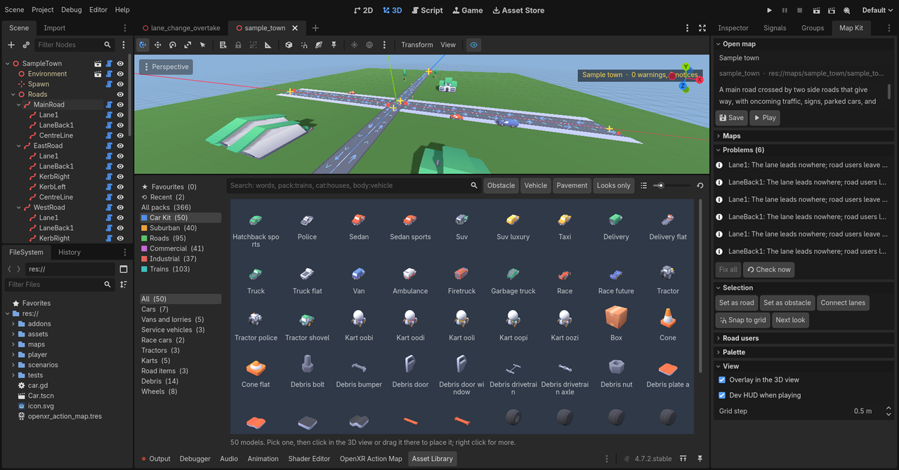

*The editor with `sample_town` open. The yellow plus signs mark open road ends, and the badge at
the top right counts the map's problems.*

**Moving around the 3D view:**

| Input | Action |
|---|---|
| Hold the right mouse button, then W, A, S, D, Q, E | Fly; Shift flies faster |
| Middle mouse button | Orbit; with Shift, pan |
| Mouse wheel | Zoom |
| F | Frame the selected node |

**Editing nodes.** Click a node in the 3D view or the scene dock to select it. The toolbar above
the 3D view switches between selecting (Q), moving (W), rotating (E), and scaling; drag the
coloured handles to move or turn along an axis. Ctrl+Z undoes and Ctrl+Shift+Z redoes, Ctrl+S
saves the scene. R is the editor's scale tool, except while a Map Kit piece is armed, when R
turns the piece. A road or lane is a curve: with it selected, its points show as handles; drag a
point to move it, drag the small handles beside a point to bend the curve there, and use the
curve tools in the 3D view's toolbar to add or delete points. To add a node by hand, select its
parent in the scene dock and press Ctrl+A (Add Child Node), then search for its type.

## A first map, step by step

1. **Create the map.** In the Map Kit dock, under **Maps**, type a name in the field (lower case
   letters, digits, and underscores, starting with a letter) and press **Create**. The map is
   made from the map base and opens. Under **Open map**, set the **Title** (press Enter) and a
   description of a sentence or two.

   <p>
   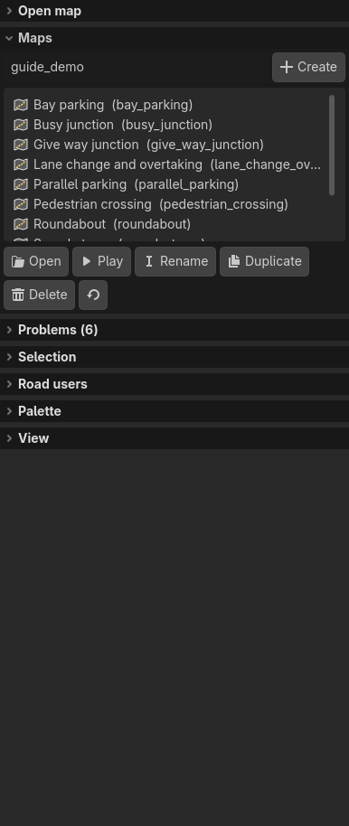
   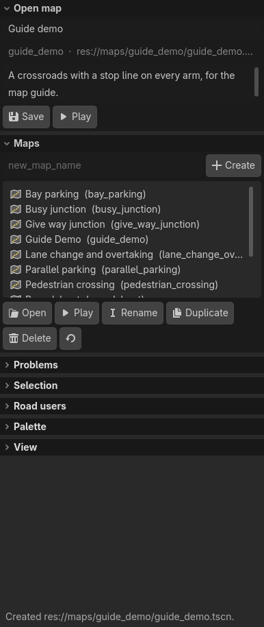
   </p>
2. **Size the ground.** Select the `Environment` node and set its `ground_size`, metres, to cover
   the roads to come (200 by 200 by default), and its `ground_offset` when the roads lie off the
   map's origin.
3. **Place the first road.** Under **Palette**, in **Roads**, pick **Road** and click in the 3D
   view. Select the road and drag its curve's points to shape it. In the inspector, set the lanes
   each way, the lane width, one way or not, the speed limit in km/h, the centre line, and the
   kerbs with their pavement width.

   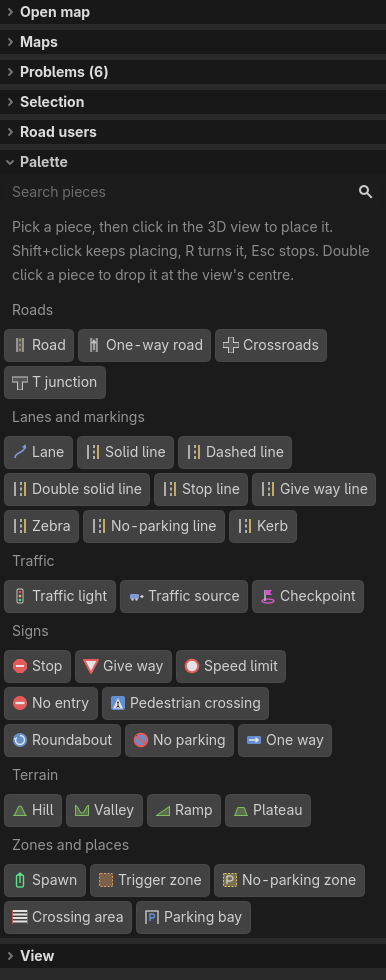

   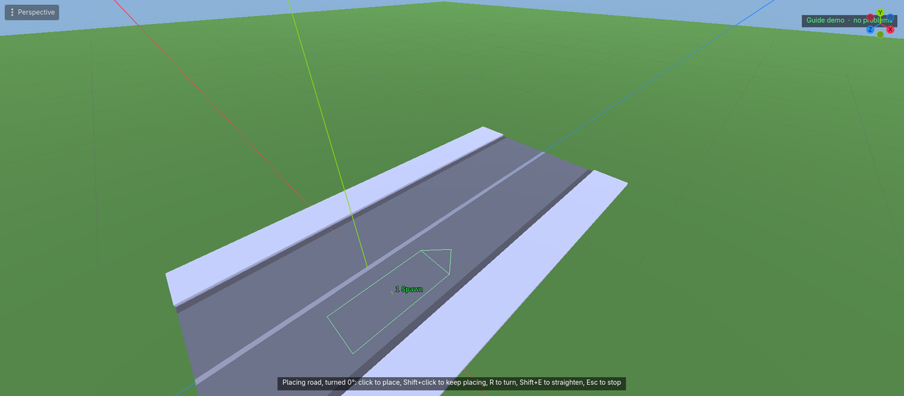

   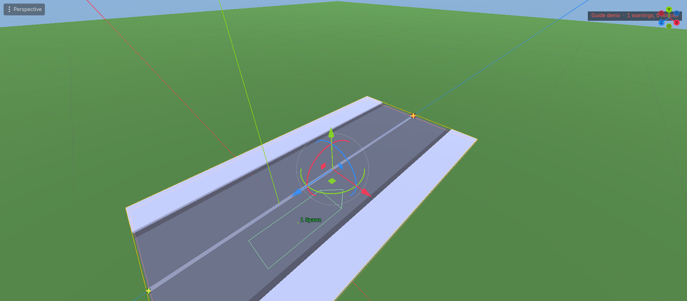
4. **Join more roads and junctions.** Pick **Road**, **Crossroads**, or **T junction** and click
   near an open road end, marked by a yellow plus in the overlay: within 3 metres the piece joins
   that end, turned to match. A junction's `road_width` is the width of the roads it joins; its
   `controlled_arms` are the arms where traffic gives way or stops, and its `line` says which.

   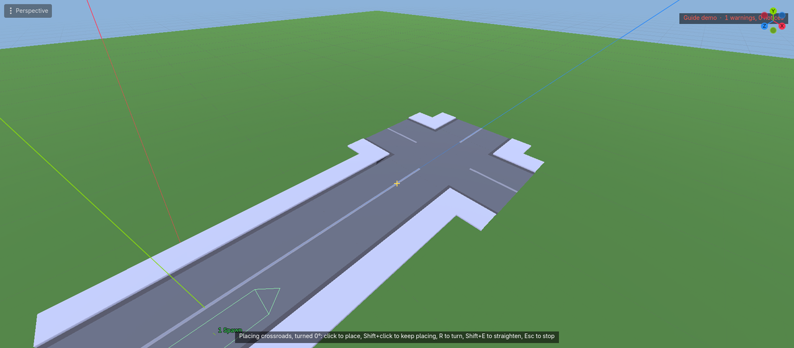
5. **Generate lanes and markings.** Select each road and press **Generate lanes** and **Generate
   markings** in the inspector; select each junction and press **Generate lines** (only on its
   controlled arms) and **Generate lanes** (one lane each way). These buttons have no undo, and
   leave the lanes unlinked, so finish with **Selection**, **Connect lanes**.

   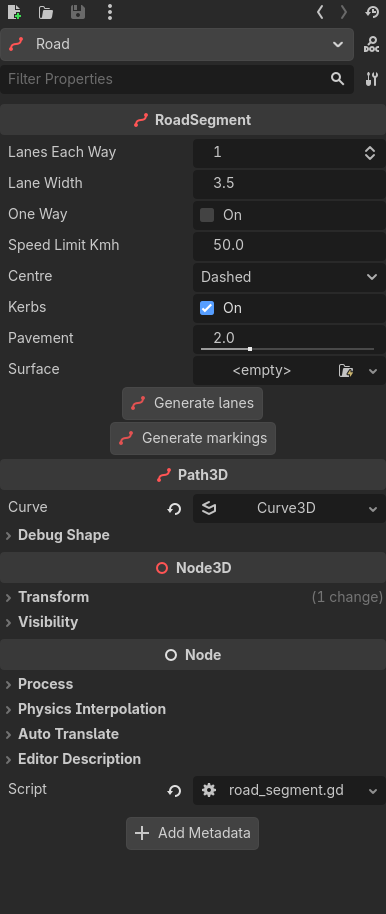

   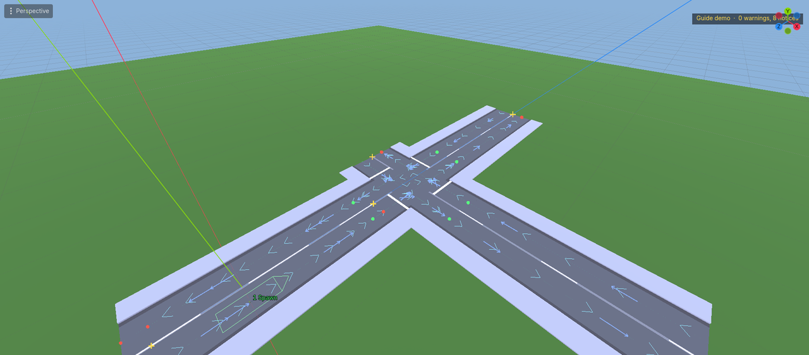
6. **Set the junction rules.** A junction's lines show where traffic stops; who gives way, and
   which lights a lane obeys, are set on the junction's lanes by hand: select a lane and set its
   `give_way_to` lanes, or its `light`.
7. **Place the start.** The map base has one `Spawn`. Move it onto a lane, facing the way the car
   drives (the car outline shows the direction). More starts are more **Spawn** pieces from
   **Zones and places**.
8. **Clear the problems.** The **Problems** section lists what is missing or wrong, and selects
   the node on a click. Rows with a fix have a button; **Fix all** applies every fix as one undo
   step. Warnings need fixing; notices, such as a lane leading off the map, may be intended.

   <p>
   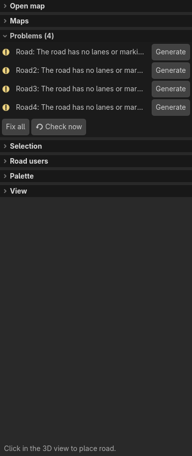
   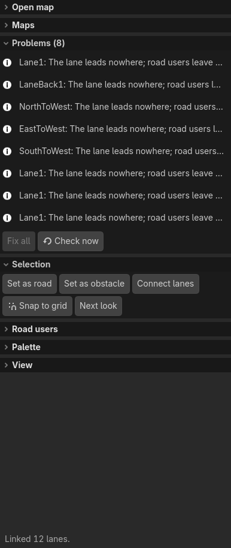
   </p>

   *Left, the problems before generating, each with its fix; right, after generating and
   connecting the lanes.*
9. **Dress the map.** In the Asset Library, pick houses, trees, fences, and parked cars and click
   to place them (see [The Asset Library](#the-asset-library)).

   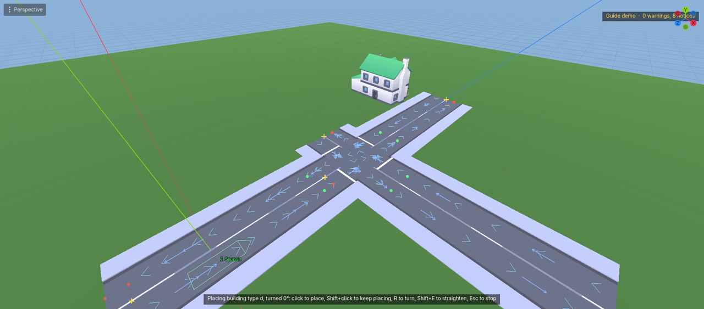

   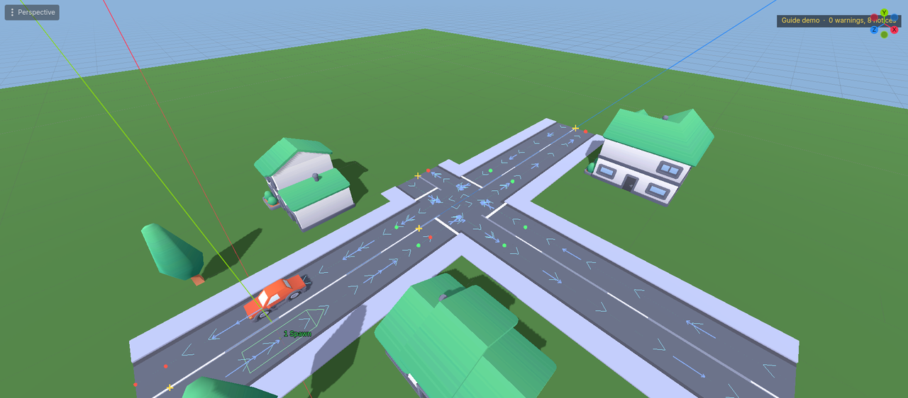
10. **Drive it.** Press **Play** under **Open map** (see [Trying a map](#trying-a-map)). Close the
    game window to come back.
11. **Save.** Ctrl+S, or **Save** under **Open map**. Commit the map folder to share it.

## The Map Kit dock

The dock's sections fold, and stay as they were left. Its title shows the open map's warning
count.

**Open map.** The open map's **Title** (press Enter to set it), its id and path, and its
description, each edited with undo. **Save** saves the map; **Play** saves it and drives it in
free drive.

**Maps.** Every map the scan finds, as "Title  (id)". **Create** makes a new map from the name in
the field. With a map selected: **Open** (or a double click), **Play**, **Rename**, **Duplicate**,
and **Delete**; the same are on the right click menu, with **Show in FileSystem**. Renaming
changes the folder, the scene, the id, and the scenarios that use the map. Duplicating asks for a
new name and title. Deleting moves the map's folder to the trash, and refuses while a scenario
uses the map. None of these can be undone. The map open in the current tab is saved and closed
first; one open in another tab is refused until it is closed by hand.

**Problems.** The open map's problems, checked again half a second after each edit, or at once
with **Check now**. The problems and their fixes:

| Problem | Fix |
|---|---|
| The map has no spawn | **Add spawn** |
| A trigger zone has no box | **Add box** |
| A road has no lanes or markings yet | **Generate** |
| A lane ends where another starts but is not linked | **Connect** |
| A road user cannot reach its checkpoint along the lanes, or stands off them | None: link the lanes on the way, or move the checkpoint onto one |
| A check is on the map | None: checks belong to a scenario |
| A lane has no curve, a source has no lane, an agent has no path, a crossing has no zone | None: set it in the inspector |
| A lane lists a crossing that is not a Crossing node | None: list the Crossing area itself |
| An agent driving to a checkpoint follows a path that is not a lane | None: set a `TrafficLane` as its path |
| A map asset has no model, or its model does not load | None: pick a model in the Asset Library |
| A model is loose: dragged in from the FileSystem dock, so nothing collides with it and **Next look** cannot change it | **Make map asset** |
| A solid map asset, prop, sign, or traffic light stands on a lane, on a road user's path, or just past either's end, where road users stop at it | **Make look only** (map assets); move the others |
| A mesh or multimesh shows nothing (notice) | **Delete** |
| A lane leads nowhere (notice) | None: road users leave the map there |
| A spawn is off the road (when the map has roads), or overlaps another (notice) | None |

**Selection.** Works on the selected nodes:

- **Set as road** gives meshes the asphalt material.
- **Set as obstacle** gives nodes a solid box on the obstacle layer: the car hits them, road
  users see them, and touching them is a fault.
- **Make map assets** makes loose models, dragged in from the FileSystem dock, into map assets
  that look the same: the selected ones, or with none selected the whole map's. Each becomes
  solid as its category says, and **Next look** works on it. Place models from the Asset Library
  to have map assets from the start.
- **Connect lanes** links the selected lanes, or all of the map's, whose ends meet.
- **Snap to grid** moves nodes onto the grid.
- **Next look** steps map assets to the next model of their category, and props and scenery to
  their next look.
- **Add terrain** gives the map a `Terrain`, sized to its ground, and turns the flat ground off.
- **Drape on terrain** sets the heights of the selected nodes, or all of the map's, from the
  terrain: roads follow the land no steeper than 12%, junctions stand on it, and lanes, markings,
  spawns, signs and props lie on the road or the land under them.

**Terrain shape.** Shown while one terrain shape (Hill, Valley, Ramp, Plateau) is selected (see
[Land with height: terrain](#land-with-height-terrain)):

- **Kind** turns it into another kind of shape.
- **Height**, **Radius** (a ramp's **Length** and **Width**), and **Falloff** set its size on
  sliders; a slider's drag is one undo step.
- **Stand on the land** moves the shape's base onto the land under it, the land without this
  shape, so a plateau's or a ramp's height counts from the ground.

In the 3D view each shape's outline lies on the land: its full effect, and its falloff beyond, with
a marker from the land up or down to the height it aims at. The selected shape has handles: drag
the radius and the falloff on the land, and the height on the marker (a ramp's length, width,
height, and falloff). They snap to half a metre, or a tenth with Shift held, and each drag is one
undo step. While a shape changes, only the land it reaches is built again, so it follows the mouse.

**Road users.** **Drive to checkpoint** turns the selected cars into road users that drive to the
selected checkpoint (see [Traffic and people](#traffic-and-people)).

**Palette.** The pieces to place, by section, with a search box:

| Section | Pieces |
|---|---|
| Roads | Road, One-way road, Crossroads, T junction |
| Lanes and markings | Lane; Solid line, Dashed line, Double solid line, Stop line, Give way line, Zebra, No-parking line, Kerb |
| Traffic | Traffic light, Traffic source, Checkpoint |
| Signs | Stop, Give way, Speed limit, No entry, Pedestrian crossing, Roundabout, No parking, One way |
| Zones and places | Spawn, Trigger zone, No-parking zone, Crossing area, Parking bay |
| Terrain | Hill, Valley, Ramp, Plateau |

Each piece goes under the map's node of its kind (`Roads`, `Lanes`, `Markings`, `Traffic`,
`Signs`, `Zones`), which keeps the scene tree in order.

**View.** **Overlay in the 3D view** shows or hides the overlay; **Dev HUD when playing** adds the
Dev HUD to **Play**; **Grid step** sets the grid pieces snap to, in metres, 0 for none.

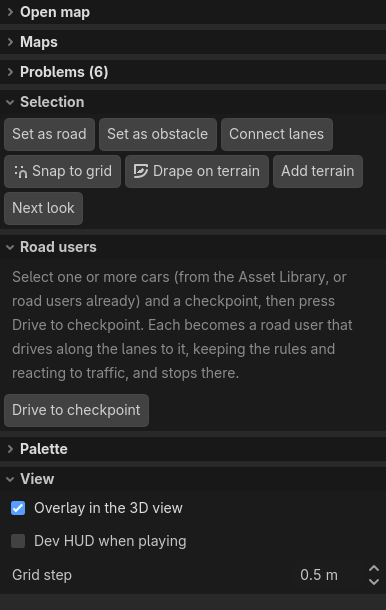

## Placing pieces and models

Picking a piece in the palette, or a model in the Asset Library, arms it: a ghost follows the
mouse over the 3D view, and a hint in the view names the piece, its turn, and the keys.

| Input | Action |
|---|---|
| Click | Place it, and stop |
| Shift+click | Place it, and keep placing |
| R | Turn a quarter |
| Shift+R | Turn 15 degrees |
| Shift+E | Straighten |
| Esc, or a right click | Stop |
| Space, with nothing armed | Arm the last piece placed again |
| Double click a palette piece; double click or Enter on a library model | Place it where the centre of the view meets the ground |

Placing snaps across to the **Grid step**. Palette pieces stand on the ground; a model stands on
whatever solid is under the mouse (a road tile, a pavement, another model's roof), or on the
ground. A model's ghost is see-through. Each model keeps the turn it was last placed with. Every
placement is one undo step.

**The overlay** draws over the open map:

| Mark | Meaning |
|---|---|
| Arrows along a lane | Its direction of travel, every 10 metres |
| Green lane end | The lane leads on to another |
| Red lane end | The lane leads nowhere |
| Yellow plus | An open road end, where roads and junctions join |
| Number and name | A spawn, in order; zones are named too |
| Magenta names | Checkpoints |
| Magenta dashed line, "to" a checkpoint | A road user's way to its checkpoint |
| Badge at the top right | The map's title, and its warning and notice counts |

The overlay button on the 3D view's toolbar also shows or hides it.

## Land with height: terrain

A new map is flat. Hills, valleys, slopes, and raised ground come from a `Terrain`, the map's land
as a grid of heights, shaped by terrain shapes placed from the palette. The roads are then laid
onto that land. The pictures here show a crossroads raised onto a plateau, with hills around it.

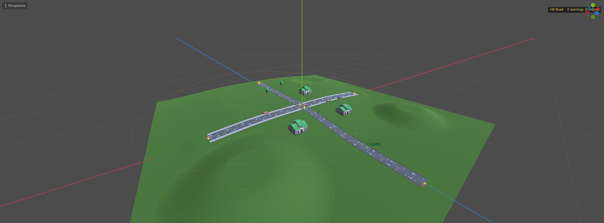

1. **Add the land.** Under **Selection**, press **Add terrain**. The map gets a `Terrain` node the
   size of its ground, and the flat ground is turned off; both are one undo step. Select the
   `Terrain` node to set, in the inspector:
   - **Size**: the land's width and length, in metres.
   - **Cell**: how far apart its heights are, 1 m by default. A smaller cell gives finer land and
     takes longer to build.
   - **Heightmap** and **Heightmap height**: an optional greyscale image for the land's relief,
     white standing that many metres above black. The shapes go on top of it.
   - **Road blend**: how far, in metres, the land eases back to its own height beside a road.
   - **Rebuild**: builds the whole land again, if it ever looks out of date.

   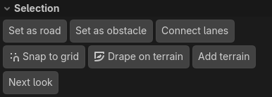

2. **Place shapes.** The palette's **Terrain** section has four shapes. Pick one and click in the
   3D view to place it, like any piece; each goes under the `Terrain` node, and they apply in
   tree order.
   - **Hill** raises the land by its height within its radius, easing out over its falloff.
   - **Valley** lowers the land the same way.
   - **Plateau** makes the land within its radius flat, at its height above the node, easing out
     over its falloff: ground for a town or a junction to stand on.
   - **Ramp** is a straight slope over a rectangle, from the node's height at one end to its
     height above that at the other, easing out at the sides.

   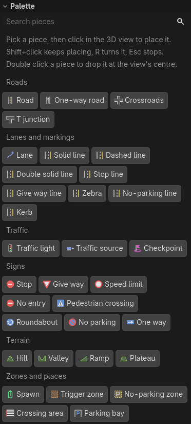

3. **Shape them in the 3D view.** Each shape's outline lies on the land: an inner line where its
   full effect ends, and an outer one where its falloff ends. An upright marker runs from the land
   to the height the shape aims at. Shapes that are not selected are drawn dimmed. The selected
   shape has round handles:
   - on a hill, valley, or plateau, one on the inner line for the radius and one on the outer line
     for the falloff, dragged across the land, and one on the marker for the height, dragged up or
     down;
   - on a ramp, its length, width, height, and falloff.

   Handles snap to half a metre, or to a tenth of a metre with Shift held, and each drag is one
   undo step. Only the land the shape reached and now reaches is built again, so the ground follows
   the mouse; the solid ground the car drives on catches up a moment after the drag ends. Move or
   turn a shape with the usual move and rotate tools.

   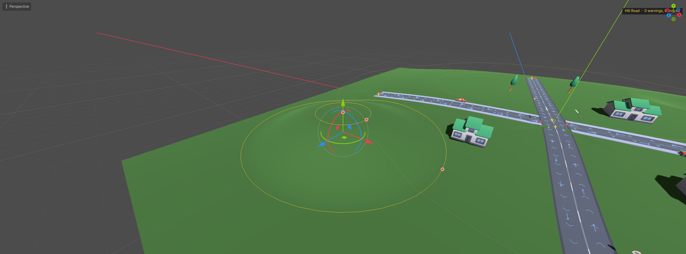

   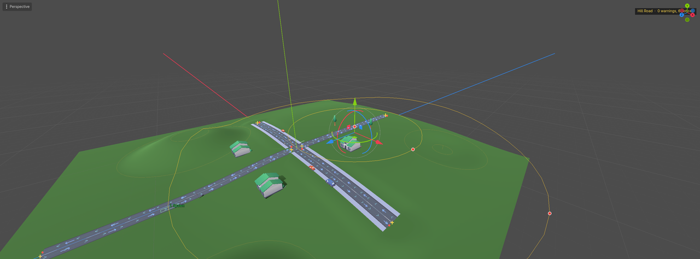

   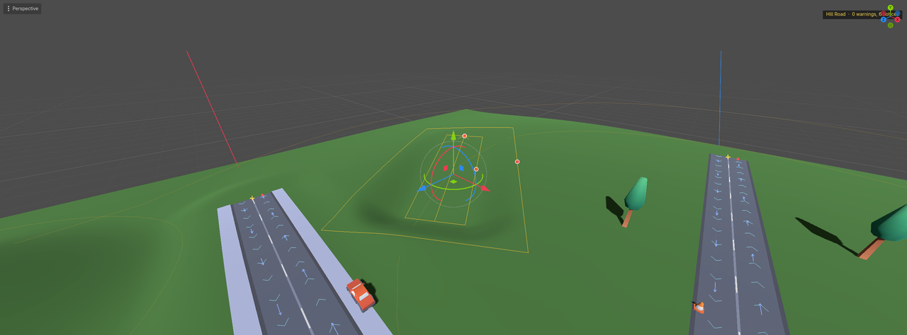

4. **Or set them in the dock.** While one shape is selected, the dock shows a **Terrain shape**
   section: **Kind** turns it into another of the four shapes, and sliders set its **Height**,
   **Radius** (a ramp's **Length** and **Width**), and **Falloff**; one slider drag is one undo
   step. **Stand on the land** moves the shape's base onto the land under it, the land without the
   shape itself, so a plateau's or a ramp's height counts from the ground there. Use it after
   placing a plateau or a ramp on ground that is not at height 0.

   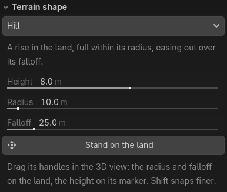

5. **Lay the roads on the land.** Roads and junctions are drawn at their own heights; under each
   one the land is cut or filled to just below the road, across the asphalt, the pavements, and a
   metre beyond, and eased back to the land over the road blend. A road drawn by hand, a flat mesh
   given the asphalt with **Set as road**, gets the same along its longer side; moving one does
   not rebuild the land by itself, so the land follows it at the next change or when the map
   loads. To make the roads follow the
   land instead of keeping their heights, press **Drape on terrain** under **Selection**: with
   nodes selected it drapes those, with none the whole map. Roads take the land's heights along
   their length, never steeper than 12%; junctions stand on the land; lanes, markings, spawns,
   signs, and props settle onto the road or the land under them. Drape again after reshaping the
   land under a road.

   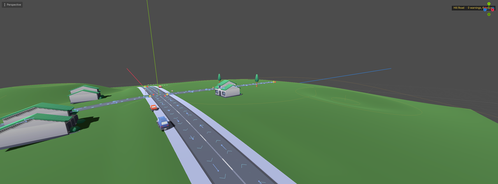

6. **Check and drive.** Clear **Problems**, then **Play**. The car climbs and descends the land,
   and road users keep to the roads' heights.

Roads never pass over one another: traffic and the exam's checks work on the ground plan, with
heights from the roads, so a bridge or an underpass cannot be built.

## The Asset Library

The Asset Library is the bottom panel listing every model under `vr-project-[car-sim]/assets/`.

**Sources and categories.** The list at the top left picks what is shown: **★ Favourites**, **⟲
Recent** (the last 20 models placed, newest first), **All packs**, or one pack (Car Kit,
Suburban, Roads, Commercial, Industrial, Trains), each pack with its colour. Below it are the
chosen source's categories, each with its count.

**Filters.** The search box matches every word typed against a model's name, label, category, and
pack; a word can name the field it matches:

| Word | Matches |
|---|---|
| `tram` | Any field |
| `pack:trains` | The pack's title or short name |
| `cat:houses` | The category |
| `body:vehicle` | The body type |

The chips beside the search show only one kind of model; more than one chip shows them together:

| Chip | In the game |
|---|---|
| Obstacle | Solid; road users see it and touching it is a fault (houses, poles, fences) |
| Vehicle | Solid, on the traffic layer, judged like a parked car (cars, lorries, trains) |
| Pavement | Stops the car's tyres (road tiles and their kerbs) |
| Looks only | Nothing collides with it (paths, awnings, railway track) |

When nothing matches, **Clear filters** clears the category, chips, and search.

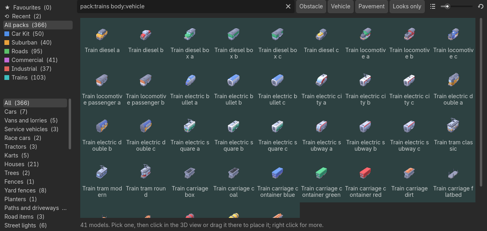

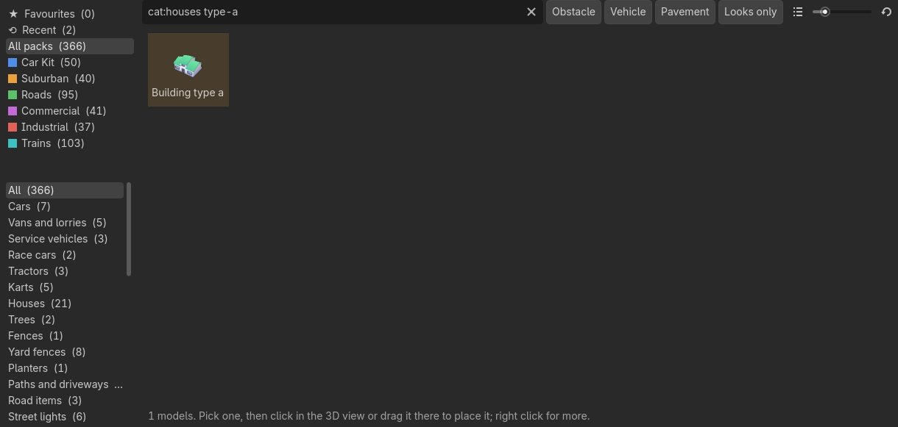

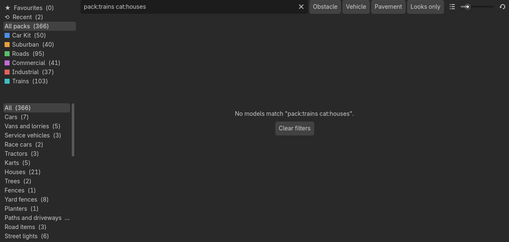

**Views.** The button beside the chips switches between thumbnails and a list; the slider sets
the thumbnail size. Each thumbnail is faintly tinted with its pack's colour, and a model whose
name two packs share is labelled with its pack, as in "Building a · Commercial". Hovering shows a
model's category, pack, and body type; picking it shows its size in metres and its triangles.

**Placing.** Pick a model and click in the 3D view, or drag the thumbnail into the view; a
double click or Enter places it at the view's centre. F marks the picked model as a favourite.
The right click menu places at the view's centre, adds to or removes from the favourites,
replaces the selected map assets with this model, shows the file, or copies its path.

**Changing a placed model.** Select map assets and use **Replace selected map assets** from a
model's right click menu, or **Selection**, **Next look** in the Map Kit dock to step through the
category. Both keep the category's settings, its body type among them.

The pane remembers its source, category, search, chips, view, size, favourites, recent models,
and turns per project.

## Traffic and people

**A steady flow.** Place a **Traffic source** and set its `lane`: road users enter that lane, with
the count, delay, headways, speed, and colours set on the source, and follow the linked lanes.

**Lights.** Place a **Traffic light** and set its cycle in the inspector (`mode`, the phase
times, a `trigger` to start it). Then select each lane that obeys it and set the lane's `light`.

**A car driving somewhere.** Place a car from the Asset Library on or beside a lane that runs its
way, and a **Checkpoint** where it is to go. Select both and press **Drive to checkpoint** under
**Road users**: the car becomes a road user that follows the lanes to the checkpoint, keeping the
rules and reacting to traffic, and stops there. The overlay draws its way as a magenta dashed
line; if the checkpoint cannot be reached, **Problems** says so.

**Pedestrians.** There is no palette piece for a pedestrian. Add a `ScriptedAgent` under
`Traffic`, turn on `pedestrian`, set its `path` (a `Path3D` across the road) and its
`body_size`, and add it to the **Crossing area**'s `pedestrians`. Then add the Crossing area to
the `crossings` of each lane that passes it, so that traffic waits while it is in use. In the game
the pedestrian shows as one of the two survivors of the retro characters kit, walking or
standing.

**Units.** A road's `speed_limit_kmh` is in km/h; a lane's `speed_limit` is in metres per second.

## Trying a map

**Play** saves the map and drives it in free drive, in the map sandbox. The controls are in the
README's [Controls](../README.md#controls), and driving is in [Driving](driving-guide.md); in the sandbox, N moves to the next map. Enter begins
the drive after the free drive note. The car starts with its engine running and the automatic in
P: Shift moves the lever to D (Ctrl to R), and W drives.

The driver sits in the Kiri '86's cabin, with an interior mirror and two door mirrors on the
car's own glass. The instrument cluster in the binnacle behind the wheel shows the speed and the
revolutions, fuel and coolant gauges, the indicator arrows, the handbrake, headlights, and reverse
tell-tales, and the engine, oil, battery, ABS, stability, and low fuel lights.

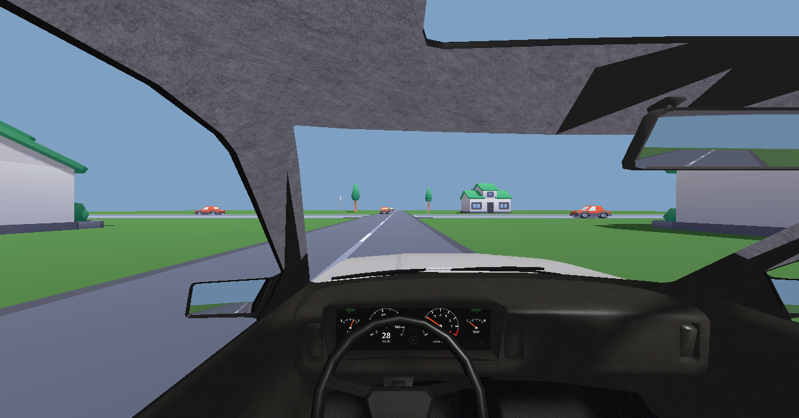

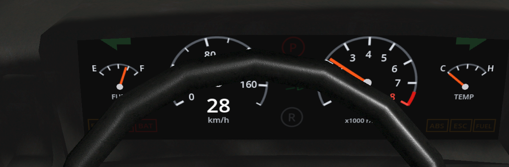

V switches to a view from behind the car, which the mouse or the right stick orbits round the car
and the mouse wheel brings closer or farther; C puts it back behind the car.

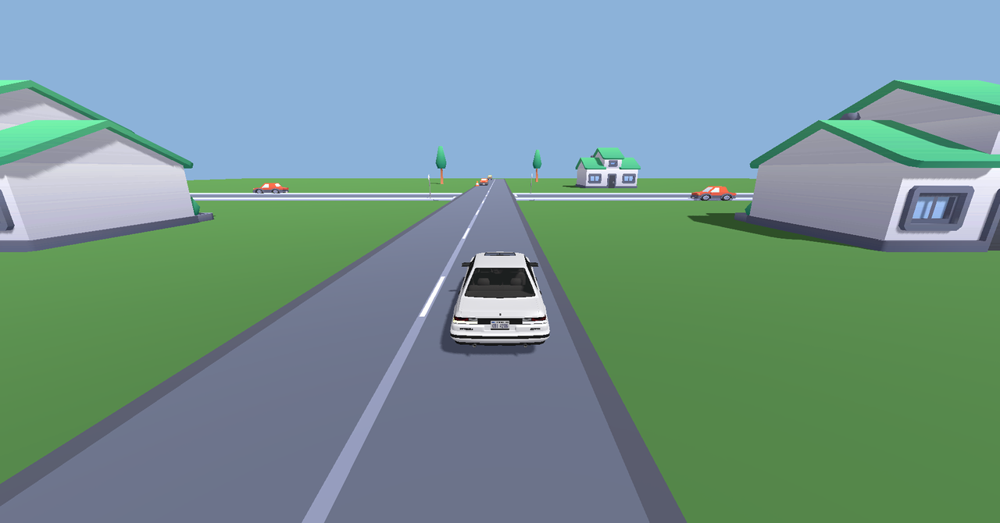

With **Dev HUD when playing** on, the game shows the Dev HUD:

| Key | Action |
|---|---|
| F3 | Hide or show the Dev HUD |
| F4 | Fly a free camera, which pauses the drive; F4 again gives the view back. Mouse to turn, W, A, S, D to move, Q and E down and up, Shift faster |
| F5, F6 | Slow time down, or speed it up, from a quarter to double |
| F7 | Pause |
| F8 | Step one tick while paused |
| F9 | Move the car to the next spawn |

A check box on its panel draws the trigger zones and lanes in 3D.


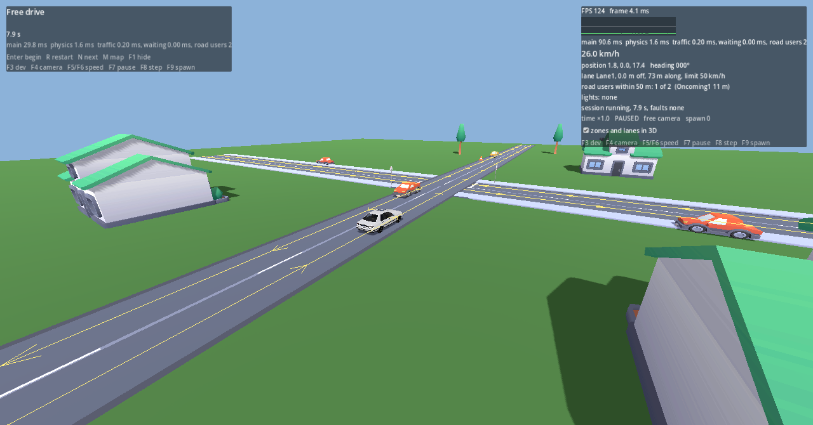

The headless tests check that every map has a `RoadMap` root, a spawn, and no checks, and that it
loads and drives for five seconds in free drive without the attempt ending; a map that breaks
them fails the test run. They run with:

```
godot --headless --xr-mode off --fixed-fps 60 --path 'vr-project-[car-sim]' -s res://tests/run_tests.gd
```

`TESTS_FILTER=map` runs only the cases whose file name contains `map`.

## Adding models: asset packs

The Asset Library lists every `.glb` model under `vr-project-[car-sim]/assets/`. A pack is a
folder of models with:

- the `.glb` models, with their `Textures/` folder;
- optionally `previews/<model>.png`, a thumbnail per model, shown until the pane's own render of
  the model is ready;
- `pack.tres`, an `AssetPack`;
- the licence or credit file.

The pack file sets the pack's **title**, its short **tag** for the pane, its **credit**, its
**scale** (metres per unit of the models), its **turn_degrees** (to face the models' fronts to
-Z), and its **categories**. Each category (`AssetCategory`) sets:

| Field | Meaning |
|---|---|
| `title` | The name listed; categories of the same name in several packs list together |
| `models` | Name patterns without `.glb`; `*` matches any text, `?` one character; a model goes to the first category it matches |
| `body` | The body type: obstacle, vehicle, or pavement; empty for looks only |
| `collider` | A box (for anything standing up) or the model's own surface (for road tiles) |
| `fit` | A size in metres to stretch every model to; 0 on an axis keeps the pack's scale |
| `extra_scale` | A further scale, for models the kit makes too small |
| `solid_part` | The solid part of the model's box per axis, such as a tree's trunk |
| `order` | Where it sorts; lower first |

`assets/kenney/city_kit_commercial/pack.tres` is a short example to copy. Drop the folder under
`assets/`, then press **Refresh** in the pane; the pane also notices a changed model or pack file
by itself. A folder without a pack file lists its models under Other, at their own size, solid.

The repository holds models free to redistribute: CC0, or CC BY with the credit kept in the pack
folder and in the README's Models section. Only `.glb` models are listed; an FBX model
is not.

## Known limits

- There is no button to generate every road at once; generate each road and junction from the
  inspector, or with the **Generate** fix in **Problems**.
- The inspector's **Generate** buttons have no undo, and leave lanes unlinked until **Connect
  lanes**.
- A kerb line along a kit road is judged but not drawn: the road draws its own kerb, and its
  pavement is solid.
- Props and scenery are no longer in the palette; existing ones still work with **Next look** and
  **Drive to checkpoint**.
- Creating, renaming, duplicating, and deleting maps cannot be undone.
- VR controllers without face buttons (Vive wands, Windows Mixed Reality) have no layout, and
  a steering wheel the platform does not present as a gamepad needs its axes set by hand in
  `user://controls.cfg`; a wheel's force feedback is not driven.

## Example maps

`maps/sample_town/` is built with the Map Kit alone: a main road crossed by two side roads that
give way, oncoming traffic, signs, parked cars, buildings, and trees, so it shows the kit's
roads, junctions, and generated lanes together.

The other maps were drawn by hand, lane by lane, before the kit:

| Map | What it holds |
|---|---|
| `bay_parking` | Parking bays, parked cars, and a no-parking zone |
| `busy_junction` | Lights, traffic flows, a crossing, a blocked lane, and a side road |
| `give_way_junction` | A minor road meeting a busy main road |
| `lane_change_overtake` | Two lanes and a slow vehicle ahead |
| `parallel_parking` | Kerbside spaces between parked cars |
| `pedestrian_crossing` | Two zebra crossings, one busy and one quiet |
| `roundabout` | Four arms and circulating traffic |
| `stop_junction` | A 30 zone, a stop junction, and a parked car |
| `traffic_lights` | Two junctions with lights, in a row |
